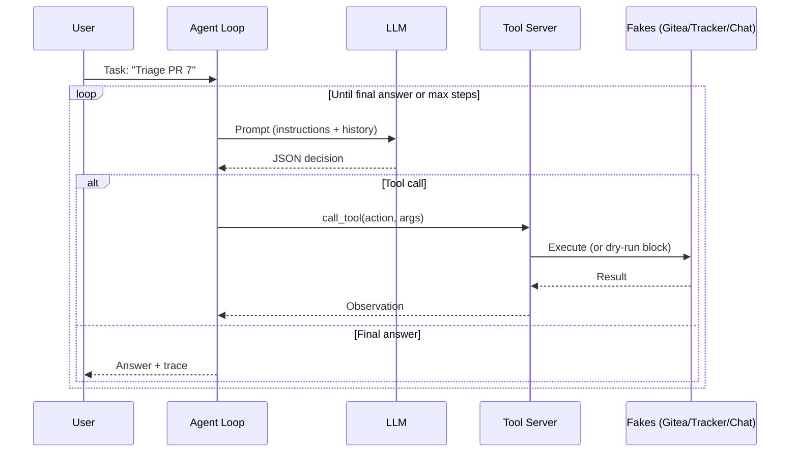

<div align="center">

# 🤖 Agent8 — LLM-Powered PR Triage Pipeline

**A minimal, hackable AI agent that reads pull requests, files issues, and notifies your team — all with tool use, dry-run safety, and idempotency built in.**


[Getting Started](#-getting-started) · [How It Works](#-how-it-works) · [Architecture](#-architecture) · [Configuration](#-configuration) · [Testing](#-testing)

</div>

---

## 📋 Overview

Agent8 demonstrates core agentic AI patterns in ~300 lines of Python:

- 🔄 **Agent Loop** — prompt → LLM → parse JSON → execute tool → observe → repeat
- 🛡️ **Dry-Run Mode** — write operations are blocked and logged as a plan
- 🔁 **Idempotency** — duplicate issue detection prevents repeated side-effects
- 🧰 **MCP-Style Tool Server** — register, validate, and dispatch tools with schema enforcement
- 🧪 **Fully Offline Testable** — fake LLM + fake backends = zero network calls

## ✨ What It Does

Given a pull request, the agent autonomously:

```
📥 Read PR #7         →  "Add rate limiting to checkout API"
📋 Check issues        →  No duplicates found
📝 Create issue        →  "PR7: rate limiting on checkout — review risk"
💬 Notify #eng         →  "PR7 (rate limiting) summarised; issue filed."
✅ Done                →  "PR 7 triaged: issue filed, team notified."
```

On a **second run**, the agent detects the existing issue and skips creation — proving idempotency.

---

## 🚀 Getting Started

### Prerequisites

- Python 3.10+
- (Optional) An API key for Claude or Gemini, or a local Ollama instance

### Installation

```bash
# Clone the repo
git clone <your-repo-url>
cd stub

# Create and activate a virtual environment
python3 -m venv .venv
source .venv/bin/activate

# Install dependencies
pip install -r requirements.txt
```

### Run the Pipeline

```bash
# With the fake LLM (no API keys needed — works fully offline)
python3 -m src.main

# With dry-run mode (writes are blocked and logged)
python3 -m src.main --dry-run
```

### (Optional) Use a Real LLM

```bash
cp .env.example .env
# Edit .env and set one of:
#   ANTHROPIC_API_KEY   → Claude
#   GEMINI_API_KEY      → Gemini
# Or just have Ollama running locally (no key needed)
python3 -m src.main
```

> [!TIP]
> The project auto-detects which LLM to use: Claude → Ollama → FakeLLM (scripted fallback).

---

## 🧠 How It Works



### The Four Tools

| Tool | Type | Description |
|------|------|-------------|
| `get_pr` | 📖 Read | Fetch a pull request by ID (title, author, diff) |
| `list_issues` | 📖 Read | List all tracker issues |
| `create_issue` | ✏️ Write | Create a tracker issue (idempotent by title) |
| `post_message` | ✏️ Write | Post a message to a chat channel |

> Write tools are **gated** — in dry-run mode they're blocked and recorded as a plan.

---

## 🏗️ Architecture

```
stub/
├── src/
│   ├── main.py          # 🎬 Entry point — runs the pipeline + idempotency demo
│   ├── agent8.py        # 🔄 Agent loop — prompt, parse, execute, observe
│   ├── tool_server.py   # 🧰 MCP-style tool server — register, validate, dispatch
│   ├── tools8.py        # 🛠️ The four integration tools
│   ├── llm_client.py    # 🧠 Multi-tier LLM client (Claude/Gemini/Ollama/Fake)
│   └── fakes.py         # 🎭 In-memory fakes for Gitea, Tracker, Chat
├── tests/
│   ├── test_server8.py  # Tool server unit tests
│   └── test_e2e8.py     # End-to-end pipeline tests
├── requirements.txt
├── .env.example
└── .gitignore
```

### Key Design Decisions

| Concept | Implementation |
|---------|---------------|
| **Tool dispatch** | Schema validation + unknown-tool rejection via `ToolError` |
| **Dry-run safety** | Write tools return `{"status": "dry-run"}` without executing |
| **Idempotency** | `create_issue` checks for existing open issues by title |
| **LLM abstraction** | `LLMClient.generate(prompt)` — any tier is swappable |
| **Offline testing** | `FakeLLMClient` returns scripted responses; fakes replace all backends |
| **Retry/backoff** | Exponential backoff + jitter to avoid thundering herd |

---

## ⚙️ Configuration

All configuration is via environment variables (or `.env` file):

| Variable | Default | Description |
|----------|---------|-------------|
| `ANTHROPIC_API_KEY` | — | Enables Claude as the LLM provider |
| `GEMINI_API_KEY` | — | Enables Gemini as the LLM provider |
| `CLAUDE_MODEL` | `claude-sonnet-5` | Claude model to use |
| `GEMINI_MODEL` | `gemini-2.5-flash` | Gemini model to use |
| `OLLAMA_MODEL` | `llama3.2` | Ollama model to use |
| `OLLAMA_BASE_URL` | `http://localhost:11434` | Ollama server URL |

---

## 🧪 Testing

```bash
# Run all tests
python3 -m pytest tests/ -v

# Run just tool server tests
python3 -m pytest tests/test_server8.py -v

# Run end-to-end tests
python3 -m pytest tests/test_e2e8.py -v
```

### What's Tested

- ✅ Tool catalog lists all 4 tools with descriptions
- ✅ Unknown tools and bad args raise `ToolError`
- ✅ `create_issue` is idempotent by title
- ✅ Dry-run blocks writes but allows reads
- ✅ Full flow: PR → issue → chat notification
- ✅ Second run creates no duplicates

---

## 📖 Tool Server Demo

Inspect the tool catalog and try manual calls:

```bash
python3 -m src.tool_server
```

Output:
```
=== tools/list: the catalog, as data ===
- get_pr        [read (free)]
- list_issues   [read (free)]
- create_issue  [WRITE (gated)]
- post_message  [WRITE (gated)]

=== tools/call: get_pr(pr_id=7), by hand, no agent ===
{ "id": 7, "title": "Add rate limiting to checkout API", ... }
```

---

<div align="center">

**Built as a teaching lab for agentic AI patterns** 🎓

*Tool use · Dry-run safety · Idempotency · Multi-model LLM routing*

</div>
